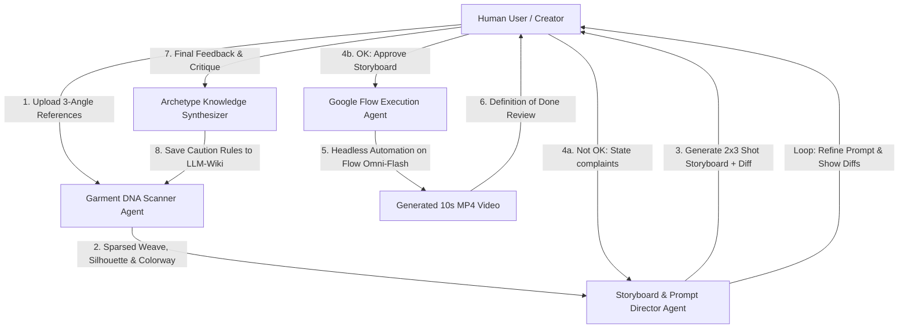

# AGENTS.md — Fashion Video AI Studio Agent Contracts & Operating Guidelines

> Standards compliant with Andrej Karpathy's guidelines (Simplicity First, Think Before Coding, Surgical Changes, Goal-Driven Execution) and the LLM-Wiki Knowledge Base architecture.

---

## 🏛️ System Mission

To autonomously analyze fashion garment reference images, compile hyper-accurate prompts and 6-shot (2x3) visual storyboards, execute 10-second Omni-Flash commercial video generations on Google Flow, and record human feedback into cumulative garment archetype knowledge so the AI never makes the same mistake twice.

---

## 🤖 Agent Roles & Responsibilities

### 1. Garment DNA Scanner Agent (The Analyst)
- **Role**: Dissects raw garment photos into physical reality (not hallucinations).
- **Core Rules**:
  - Identify garment category: knitwear, silk evening gown, denim jacket, pleated skirt, linen set.
  - Distinguish woven patterns vs printed graphics: e.g., *Intarsia knit weave* vs *screen-printed sticker*.
  - Identify critical trims: ribbed collars, sleeve cuffs, hem bands, zippers, buttons.
  - Query `wiki/concepts/garment-archetypes/` for known caution rules before generating prompts.

### 2. Storyboard & Prompt Director Agent (The Core Screen)
- **Role**: Builds the 6-shot (2x3 grid) visual storyboard and compiles the unified Omni-Flash prompt.
- **2x3 Storyboard Grid Standard**:
  - **Shot 1 (00-02s)**: Opening 3D Orbit & Full Silhouette uncropped (`@dress_front_cutout`).
  - **Shot 2 (02-04s)**: Chest, Collar & Neckline Detail.
  - **Shot 3 (04-06s)**: Macro Texture Zoom & Intarsia/Fabric Weave (`@fabric_zoom_cutout`).
  - **Shot 4 (06-07s)**: Sleeve Cuffs, Hemline Ribbing & Waist Detail.
  - **Shot 5 (07-09s)**: Runway Walking & Dynamic Poise (no violent arm swings).
  - **Shot 6 (09-10s)**: 360 Turn displaying back drapery (`@dress_back_cutout`) & Brand Outro.
- **Feedback & Diff Loop**:
  - When user dislikes a prompt or storyboard, the agent must output a clear **Diff**:
    - 🟢 `Added`: What new tokens/directives were introduced.
    - 🟡 `Modified`: What pacing/angles were adjusted.
    - 🔴 `Negatives`: What commands were forbidden to stop regressions.

### 3. Google Flow Execution Agent (The Producer)
- **Role**: Accesses Google Flow (`https://labs.google/fx/tools/flow`) via Playwright browser automation or session bridge.
- **Hard Gates**:
  - Mode: `Video` -> `9:16` -> `10s` (Omni Flash).
  - Attach isolated product cutout tokens (`@dress_front_cutout`, `@dress_back_cutout`, `@fabric_zoom_cutout`).
  - Unified Audio-Visual Prompt containing `[VOICEOVER]`, `[SFX]`, `[BGM]`.
  - Monitor render completion and download the generated MP4.

### 4. Archetype Knowledge Synthesizer (The Memory Engine)
- **Role**: Takes user feedback at the end of the job and permanently writes caution rules to `wiki/concepts/garment-archetypes/<category>.md`.
- **Knowledge Compounding**:
  - If a user reports: *"แขนเสื้อยาวเกินไป ลายดอกไม้เบี้ยว"*
  - The agent files:
    - Category: `knitwear/fair-isle`
    - Caution: "Always lock short sleeve length above elbow; intarsia floral stripes drift during torso twisting."
  - Future jobs on similar knitwear automatically inherit these rules.

---

## 📜 Karpathy Rules of Engagement

1. **Simplicity First**: Minimum code that solves the user's workflow. The main screen must be the Storyboard + Prompt Iteration Loop.
2. **Surgical Precision**: Touch only what is needed to make the workflow effortless.
3. **No Speculative Abstractions**: Do not build unused multi-tier layers. The user asked for a 2x3 Storyboard grid, a direct Flow trigger, and an AI memory wiki — deliver exactly that.
