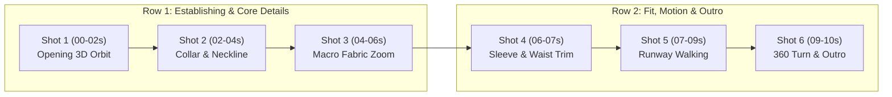

# Storyboard Engine: 2x3 Grid Visual Specification

> Standard for 10-Second Omni-Flash Commercial Fashion Video Ads.

---

## 🎬 The 6-Beat (2x3) Architecture

To give the human creator 100% clarity on how the 10-second video will look *before* spending time and compute on Google Flow, the video is broken into a **2x3 grid of 6 storyboard shots**:

### Shot Specifications:
1. **Shot 1 (00-02s) — Full Silhouette Establishing**:
   - Reference token: `@dress_front_cutout`
   - Motion: Smooth 3D circular orbit showcasing whole garment uncropped.
   - VO hook: "ชุดเดรสทรงสวยสำหรับผู้หญิงยุคใหม่..."
2. **Shot 2 (02-04s) — Collar, Chest & Neckline Detail**:
   - Framing: Medium close-up focusing on neckline, collar ribbing, and upper chest motifs.
   - Zero-morphing lock: Collar shape must remain rigid.
3. **Shot 3 (04-06s) — Macro Fabric & Weave Texture**:
   - Reference token: `@fabric_zoom_cutout`
   - Framing: Extreme macro shot showing the fine knit yarn, thread weave, or silk luster.
   - SFX: Soft fabric rustle.
4. **Shot 4 (06-07s) — Cuffs, Waist & Silhouette Fit**:
   - Framing: Waistline definition, sleeve cuffs, and tailored fit to model's body.
5. **Shot 5 (07-09s) — Runway Motion & Fluidity**:
   - Motion: Model walking with confident graceful runway poise; fabric drapery in motion.
   - Constraint: No violent arm swings or rapid twisting that distorts garment geometry.
6. **Shot 6 (09-10s) — 360 Turn & Brand Outro**:
   - Reference token: `@dress_back_cutout`
   - Motion: Elegant slow-motion spin showing back drapery and closing logo accent.
